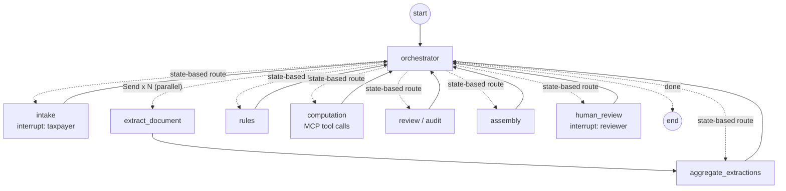

# SilverFile

SilverFile is a multi-agent LangGraph prototype that prepares a **draft** 2025 Form 1040-SR, with a provenance record for every dollar amount and human review for anything it should not decide. It was built for ENMGT 5405 Assignment 7 (see [Assignment-7-Details.md](Assignment-7-Details.md)).

- Fictional data only. The system accepts only 900–999 test Social Security numbers.
- Nothing is filed. "Submitted" means submitted internally for Kushim human review.
- No tax advice. Advice requests are noted and routed to a person.

> **Status:** the core automated suite, which now includes the OCR-independent integration tests, passes (see [Verification status](#verification-status)). Reading real document images, the browser flow, the live Anthropic API, Docker and CI have **not** been verified. See [docs/KNOWN_LIMITATIONS.md](docs/KNOWN_LIMITATIONS.md).

## Orchestration

Hub and spoke around a deterministic orchestrator (transcribed from [src/graph.py](src/graph.py); `python run.py graph` regenerates the machine-drawn version as `docs/graph.mmd`):



The review → computation/extraction → review cycle is bounded (`MAX_REVIEW_PASSES = 3`), and a loop guard stops automatic hand-offs that make no progress. Details are in [docs/IMPLEMENTATION_NOTES.md](docs/IMPLEMENTATION_NOTES.md).

## Requirements

- **Python 3.12** is the team standard. It matches the Docker image (`python:3.12-slim`), CI and [.python-version](.python-version). Other versions are not verified.
- All dependencies are pinned in [requirements.txt](requirements.txt). The per-person requirement files have been removed.
- **Reading document images uses Anthropic vision**, which needs an API key *and* a model available to your account. Without them the app runs in offline mode: rule-based intake parsing, and document images can only be read by native OCR, which is disabled (see [docs/KNOWN_LIMITATIONS.md](docs/KNOWN_LIMITATIONS.md)).

## Installation

From the repository root:

```bash
python3.12 -m venv .venv     # Windows: py -3.12 -m venv .venv   (or: uv venv .venv --python 3.12)
# Windows (PowerShell):  .venv\Scripts\Activate.ps1
# Windows (Git Bash):    source .venv/Scripts/activate
# macOS / Linux:         source .venv/bin/activate
python -m pip install -r requirements.txt
```

## Configuration

Copy [.env.example](.env.example) to `.env` and fill it in. **Never commit `.env`.**

| Variable | Meaning |
|---|---|
| `ANTHROPIC_API_KEY` | Key for live model mode; leave empty for offline mode |
| `ANTHROPIC_MODEL` | **Required for live mode.** A vision + structured-output model available to your account. There is no default; if it is empty in `anthropic` mode, the app and `run.py check` stop with a configuration error |
| `SILVERFILE_LLM_MODE` | `anthropic` (default in the example), `offline`, or unset (`auto`: anthropic when a key is present) |
| `SILVERFILE_VAR_DIR` | Runtime data directory (case database, checkpoints, uploads, drafts); default `./var`, git-ignored |
| `SILVERFILE_CONTEXT_STRATEGY` | `true` enables selective-recall context (§4.5) |
| `SILVERFILE_ENABLE_NATIVE_OCR` | Keep `0`. Native OCR is blocked pending isolated validation |
| `LANGSMITH_TRACING`, `LANGCHAIN_TRACING_V2` | Keep `false` |

Check the configuration, the MCP tax tools and (if configured) the API. It prints whether a key and a model are set, never their values. When both are configured, it makes one small API call:

```bash
python run.py check
```

## Starting the app

```bash
python run.py ui            # or: python -m streamlit run streamlit_app.py
```

Open http://localhost:8501. The sidebar switches between **Taxpayer intake**, **Employee dashboard** and **Draft & provenance**.

With Docker (supplied but **not yet verified**):

```bash
docker compose up --build
```

## Demo and evaluation cases

- [demo/eval_case_1.md](demo/eval_case_1.md): a clean minimal run, with step-by-step answers.
- [demo/eval_case_2.md](demo/eval_case_2.md): a user/document conflict that triggers human review, then resolution in the dashboard.

Scripted equivalents:

```bash
python run.py demo eval_case_1
python run.py demo eval_case_2            # stops at the human-review event
python run.py demo eval_case_2 --review   # also plays the reviewer decision
python run.py eval                        # every case in evals/cases.json; writes traces/
```

These scripted runs read the fixture images, so they need live vision (or validated native OCR) and have not been run on this build. The same scenarios run without OCR in the integration tests below. See [docs/KNOWN_LIMITATIONS.md](docs/KNOWN_LIMITATIONS.md).

## Context-window benchmark (§4.5)

`docs/metrics.md` holds the measured token counts with selective recall off and on. It has **not been generated yet**, because it needs real API calls. To produce it, a team member with an Anthropic API key:

1. Installs as above, copies `.env.example` to `.env` and sets `ANTHROPIC_API_KEY` and `ANTHROPIC_MODEL` (a vision-capable model). Keeps `SILVERFILE_ENABLE_NATIVE_OCR=0`.
2. Runs `python run.py check`. It should end with `All checks passed.` (one small paid call).
3. Runs the benchmark, which makes 20 extraction calls: 10 with the strategy off (the whole thread is resent, about 55 images in total), then 10 with it on (one image each). Expect roughly 100–120k input tokens overall.

   ```bash
   python run.py benchmark --all
   ```

   This writes `traces/benchmark_strategy_off.json`, `traces/benchmark_strategy_on.json`, `docs/metrics.md` and `docs/metrics_chart.png`. If it stops partway, run it again; it starts over. A missing key or model stops it before any call.
4. Checks `docs/metrics.md`: the heading reads "Measured input tokens per document", the totals line gives the saving, and "Result consistency" is `10/10` (if not, the report must say which documents differ).
5. Commits those four files and updates the §4.5 status in this README, [docs/ACCEPTANCE_RESULTS.md](docs/ACCEPTANCE_RESULTS.md), [docs/KNOWN_LIMITATIONS.md](docs/KNOWN_LIMITATIONS.md) and [docs/REQUIREMENTS_MATRIX.md](docs/REQUIREMENTS_MATRIX.md). **Never commit `.env`.**

`tests/unit/test_context_benchmark.py` runs the same flow offline with a fake client to check the harness and report. Its numbers are not measurements.

## Tests

Disable third-party pytest plugins and tracing. The core suite, which is the same command CI runs:

```bash
# bash
PYTEST_DISABLE_PLUGIN_AUTOLOAD=1 LANGSMITH_TRACING=false LANGCHAIN_TRACING_V2=false \
  python -m pytest tests --ignore=tests/live --ignore=tests/native_ocr -q -rs
```

```powershell
# PowerShell
$env:PYTEST_DISABLE_PLUGIN_AUTOLOAD="1"; $env:LANGSMITH_TRACING="false"; $env:LANGCHAIN_TRACING_V2="false"
python -m pytest tests --ignore=tests/live --ignore=tests/native_ocr -q -rs
```

| Folder | What it covers | Runs in the core suite? |
|---|---|---|
| `tests/unit`, `tests/intake` … `tests/audit` | Reducers, memory/store, graph shape, fixture definitions, model configuration, intake, extraction, provenance, PDF, rules, tax math, audit recheck, MCP contract, uploads | Yes |
| `tests/integration/test_orchestration_synthetic.py` | Real graph and stdio MCP server, with **synthetic extraction records** in place of image reading: all draft cases against hand-worked results, eval case 2 human review, document-driven stops, parallel extraction, bounded review cycle, review bound, loop-guard hand-off cap, audit recheck of 6b | Yes. Not evidence of OCR or vision accuracy |
| `tests/integration/test_end_to_end.py`, `test_live_path_mocked.py` | Same graph with real fixture **images** (`needs_ocr`), plus OCR-free tests: loop-guard cycle, restart persistence, intake-only stops, structured-output retry | OCR-free tests yes. `needs_ocr` tests are skipped unless `SILVERFILE_ENABLE_NATIVE_OCR=1` |
| `tests/native_ocr` | Native OCR accuracy | No. Skipped unless native OCR is enabled |
| `tests/live` | Real Anthropic API (paid) | No. Needs `ANTHROPIC_API_KEY`, `ANTHROPIC_MODEL` and `SILVERFILE_RUN_LIVE_TESTS=1` |

Do not enable native OCR outside a network-isolated environment (see [docs/KNOWN_LIMITATIONS.md](docs/KNOWN_LIMITATIONS.md)).

## Verification status

- **Expanded core suite (this branch):** 372 passed and 23 skipped (the `needs_ocr` image tests) on Windows 11, Python 3.12.14. Run by Claude Code at Hussain's request; see [docs/ACCEPTANCE_RESULTS.md](docs/ACCEPTANCE_RESULTS.md).
- **Earlier core suite (`aeda711`):** 299 passed in 6.18 s on Python 3.12, run independently by ChatGPT/Codex (externally reported). The previous core command also passed 299 on the same Windows machine before this branch's changes.
- **Not verified:** reading real document images (live vision or native OCR), the browser workflow, live Anthropic API, Docker build, a GitHub Actions run, and `python run.py eval` with images. Passing synthetic-extraction tests is not evidence of extraction accuracy.

All recorded results are in [docs/ACCEPTANCE_RESULTS.md](docs/ACCEPTANCE_RESULTS.md). The requirement-by-requirement status is in [docs/REQUIREMENTS_MATRIX.md](docs/REQUIREMENTS_MATRIX.md).

## Repository layout

| Path | Contents |
|---|---|
| `src/graph.py`, `src/agents/` | LangGraph graph, orchestrator and agents |
| `src/service.py`, `src/driver.py` | Service API used by the UI, CLI and tests; scripted case runner |
| `src/state.py`, `src/memory.py`, `src/store.py` | Shared state and reducers, context construction, case index |
| `src/hitl.py`, `src/provenance.py`, `src/ssn.py`, `src/money.py` | Escalation reasons and actions, provenance, fictional-SSN rule, currency |
| `src/tools/`, `mcp_server/` | MCP client, deterministic tax functions, MCP server, OCR/document input |
| `src/output/`, `src/ui/`, `streamlit_app.py` | PDF filling, Streamlit taxpayer and dashboard views |
| `data/` | Policy, rule registry, source manifest, reference forms, fictional fixtures |
| `evals/` | Case catalogue and hand-worked expected results |
| `demo/` | Eval-case instructions and demo images |
| `scripts/` | Context benchmark, UI smoke script, source-manifest builder |
| `docs/` | Documentation (below) |

## Documentation

- [docs/IMPLEMENTATION_NOTES.md](docs/IMPLEMENTATION_NOTES.md): architecture, agents, memory, orchestration, human review, design decisions
- [docs/STATE_CONTRACT.md](docs/STATE_CONTRACT.md): state fields, writers, reducers, versions and invariants
- [docs/ASSUMPTIONS.md](docs/ASSUMPTIONS.md): assignment requirements versus team choices versus open questions
- [docs/REQUIREMENTS_MATRIX.md](docs/REQUIREMENTS_MATRIX.md): assignment requirements mapped to files, tests and status
- [docs/ACCEPTANCE_RESULTS.md](docs/ACCEPTANCE_RESULTS.md): recorded test results, and what has not been run
- [docs/KNOWN_LIMITATIONS.md](docs/KNOWN_LIMITATIONS.md): unresolved issues and remaining validation
- [docs/CONTRIBUTIONS.md](docs/CONTRIBUTIONS.md): member responsibilities and documented contributions
- [docs/AI_DISCLOSURE.md](docs/AI_DISCLOSURE.md): AI assistance and inherited-source attribution
- [docs/REPORT_AND_DEMO_CHECKLIST.md](docs/REPORT_AND_DEMO_CHECKLIST.md): remaining report and recording work. This is a checklist, not the report
- [docs/BASELINE.md](docs/BASELINE.md) and `docs/*_sources.json`: original source commit and file-hash manifests
- [data/policy.md](data/policy.md): the operating policy every agent follows
