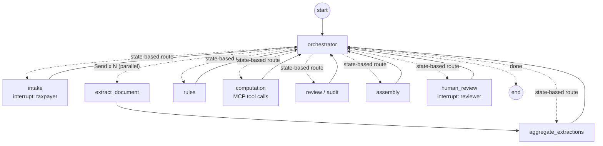

# SilverFile

SilverFile is a multi-agent LangGraph prototype that prepares a **draft** 2025 Form 1040-SR, with a provenance record for every dollar amount and human review for anything it should not decide. It was built for ENMGT 5405 Assignment 7 (see [Assignment-7-Details.md](Assignment-7-Details.md)).

- Fictional data only. The system accepts only 900–999 test Social Security numbers.
- Nothing is filed. "Submitted" means submitted internally for Kushim human review.
- No tax advice. Advice requests are noted and routed to a person.

> **Status:** the core automated suite (299 tests) has an externally reported passing run on this build (see [Verification status](#verification-status)). The browser flow, live Anthropic API, native OCR, Docker, CI and the end-to-end integration tests have **not** been verified. See [docs/KNOWN_LIMITATIONS.md](docs/KNOWN_LIMITATIONS.md).

## Orchestration

Hub and spoke around a deterministic orchestrator (transcribed from [src/graph.py](src/graph.py); `python run.py graph` regenerates the machine-drawn version as `docs/graph.mmd`):



The review → computation/extraction → review cycle is bounded (`MAX_REVIEW_PASSES = 3`), and a loop guard stops automatic hand-offs that make no progress. Details are in [docs/IMPLEMENTATION_NOTES.md](docs/IMPLEMENTATION_NOTES.md).

## Requirements

- Python 3.12, which matches the Docker image, CI and the reported core verification. See the version note in [docs/KNOWN_LIMITATIONS.md](docs/KNOWN_LIMITATIONS.md).
- All dependencies are pinned in [requirements.txt](requirements.txt). The per-person requirement files have been removed.
- An Anthropic API key and a model available to your account, if you want live model mode. Without a key, the app runs in offline mode (rule-based intake parsing, with OCR for images).

## Installation

From the repository root:

```bash
python -m venv .venv
# Windows (PowerShell):  .venv\Scripts\Activate.ps1
# Windows (Git Bash):    source .venv/Scripts/activate
# macOS / Linux:         source .venv/bin/activate
python -m pip install -r requirements.txt
```

## Configuration

Copy [.env.example](.env.example) to `.env` and fill it in. **Never commit `.env`.**

| Variable | Meaning |
|---|---|
| `ANTHROPIC_API_KEY` | Key for live model mode; leave empty for offline mode |
| `ANTHROPIC_MODEL` | A vision + structured-output model available to your account. No identifier is assumed valid; `src/config.py` falls back to a built-in default if this is empty |
| `SILVERFILE_LLM_MODE` | `anthropic` (default in the example) or `offline` |
| `SILVERFILE_VAR_DIR` | Runtime data directory (case database, checkpoints, uploads, drafts); default `./var`, git-ignored |
| `SILVERFILE_CONTEXT_STRATEGY` | `true` enables selective-recall context (§4.5) |
| `SILVERFILE_ENABLE_NATIVE_OCR` | Keep `0`. Native OCR is blocked pending isolated validation |
| `LANGSMITH_TRACING`, `LANGCHAIN_TRACING_V2` | Keep `false` |

Check the configuration, the MCP tax tools and (if configured) the API:

```bash
python run.py check
```

## Starting the app

```bash
python run.py ui            # or: python -m streamlit run streamlit_app.py
```

Open http://localhost:8501. The sidebar switches between **Taxpayer intake**, **Employee dashboard** and **Draft & provenance**.

With Docker (supplied but **not yet verified**):

```bash
docker compose up --build
```

## Demo and evaluation cases

- [demo/eval_case_1.md](demo/eval_case_1.md): a clean minimal run, with step-by-step answers.
- [demo/eval_case_2.md](demo/eval_case_2.md): a user/document conflict that triggers human review, then resolution in the dashboard.

Scripted equivalents:

```bash
python run.py demo eval_case_1
python run.py demo eval_case_2            # stops at the human-review event
python run.py demo eval_case_2 --review   # also plays the reviewer decision
python run.py eval                        # every case in evals/cases.json; writes traces/
```

These scripted runs have not been re-run against the merged build. See [docs/KNOWN_LIMITATIONS.md](docs/KNOWN_LIMITATIONS.md).

## Tests

Disable third-party pytest plugins and tracing. The core suite, which is the same command CI runs:

```bash
# bash
PYTEST_DISABLE_PLUGIN_AUTOLOAD=1 LANGSMITH_TRACING=false LANGCHAIN_TRACING_V2=false \
  python -m pytest tests --ignore=tests/integration --ignore=tests/live --ignore=tests/person3_ocr -q
```

```powershell
# PowerShell
$env:PYTEST_DISABLE_PLUGIN_AUTOLOAD="1"; $env:LANGSMITH_TRACING="false"; $env:LANGCHAIN_TRACING_V2="false"
python -m pytest tests --ignore=tests/integration --ignore=tests/live --ignore=tests/person3_ocr -q
```

| Folder | What it covers | Runs in the core suite? |
|---|---|---|
| `tests/unit`, `tests/person2` … `tests/person6` | Reducers, memory/store, graph shape, intake, extraction, provenance, PDF, rules, tax math, MCP contract, uploads | Yes |
| `tests/integration` | End-to-end graph runs: eval cases, mandatory stops, parallel extraction, bounded review cycle, **loop guard**, restart persistence | **No.** Skipped unless `SILVERFILE_ENABLE_NATIVE_OCR=1` |
| `tests/person3_ocr` | Native OCR accuracy | No. Skipped unless native OCR is enabled |
| `tests/live` | Real Anthropic API | No. Needs `ANTHROPIC_API_KEY` and `SILVERFILE_RUN_LIVE_TESTS=1` |

Do not enable native OCR outside a network-isolated environment (see [docs/KNOWN_LIMITATIONS.md](docs/KNOWN_LIMITATIONS.md)).

## Verification status

- **Externally reported:** ChatGPT/Codex ran the core command above against `main` at `aeda711`: 299 passed in 6.18 s on Python 3.12. The 299 include a real stdio MCP call, tax-table comparisons, graph topology and upload-boundary checks. No team member has recorded their own run on this build yet.
- **Not verified:** the browser workflow, live Anthropic API, native OCR, Docker build, a GitHub Actions run, the `tests/integration` end-to-end suite, and the full fixture evaluations.

All recorded results are in [docs/ACCEPTANCE_RESULTS.md](docs/ACCEPTANCE_RESULTS.md). The requirement-by-requirement status is in [docs/REQUIREMENTS_MATRIX.md](docs/REQUIREMENTS_MATRIX.md).

## Repository layout

| Path | Contents |
|---|---|
| `src/graph.py`, `src/agents/` | LangGraph graph, orchestrator and agents |
| `src/service.py`, `src/driver.py` | Service API used by the UI, CLI and tests; scripted case runner |
| `src/state.py`, `src/memory.py`, `src/store.py` | Shared state and reducers, context construction, case index |
| `src/hitl.py`, `src/provenance.py`, `src/ssn.py`, `src/money.py` | Escalation reasons and actions, provenance, fictional-SSN rule, currency |
| `src/tools/`, `mcp_server/` | MCP client, deterministic tax functions, MCP server, OCR/document input |
| `src/output/`, `src/ui/`, `streamlit_app.py` | PDF filling, Streamlit taxpayer and dashboard views |
| `data/` | Policy, rule registry, source manifest, reference forms, fictional fixtures |
| `evals/` | Case catalogue and hand-worked expected results |
| `demo/` | Eval-case instructions and demo images |
| `scripts/` | Context benchmark, UI smoke script, source-manifest builder |
| `docs/` | Documentation (below) |

## Documentation

- [docs/IMPLEMENTATION_NOTES.md](docs/IMPLEMENTATION_NOTES.md): architecture, agents, memory, orchestration, human review, design decisions
- [docs/STATE_CONTRACT.md](docs/STATE_CONTRACT.md): state fields, writers, reducers, versions and invariants
- [docs/ASSUMPTIONS.md](docs/ASSUMPTIONS.md): assignment requirements versus team choices versus open questions
- [docs/REQUIREMENTS_MATRIX.md](docs/REQUIREMENTS_MATRIX.md): assignment requirements mapped to files, tests and status
- [docs/ACCEPTANCE_RESULTS.md](docs/ACCEPTANCE_RESULTS.md): recorded test results, and what has not been run
- [docs/KNOWN_LIMITATIONS.md](docs/KNOWN_LIMITATIONS.md): unresolved issues and remaining validation
- [docs/CONTRIBUTIONS.md](docs/CONTRIBUTIONS.md): member responsibilities and documented contributions
- [docs/AI_DISCLOSURE.md](docs/AI_DISCLOSURE.md): AI assistance and inherited-source attribution
- [docs/REPORT_AND_DEMO_CHECKLIST.md](docs/REPORT_AND_DEMO_CHECKLIST.md): remaining report and recording work. This is a checklist, not the report
- [docs/BASELINE.md](docs/BASELINE.md) and `docs/*_sources.json`: original source commit and file-hash manifests
- [data/policy.md](data/policy.md): the operating policy every agent follows
