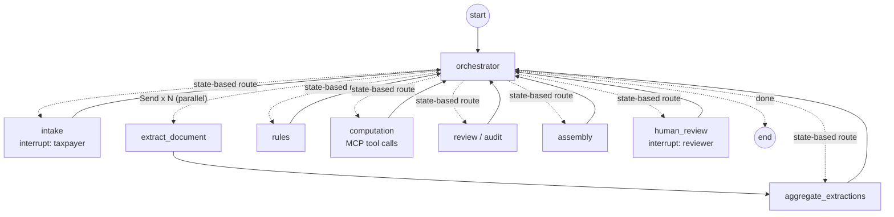

# SilverFile

SilverFile is a multi-agent LangGraph prototype that prepares a **draft** 2025 Form 1040-SR, with a provenance record for every dollar amount and human review for anything it should not decide. It was built for ENMGT 5405 Assignment 7 (see [Assignment-7-Details.md](Assignment-7-Details.md)).

- Fictional data only. The system accepts only 900–999 test Social Security numbers.
- Nothing is filed. "Submitted" means submitted internally for Kushim human review.
- No tax advice. Advice requests are noted and routed to a person.

> **Status:** the full automated suite passes, including reading the W-2 and other fixture images with the built-in OCR, and `python run.py eval` passes all 19 cases with no API key (see [Verification status](#verification-status)). The browser flow and Docker deployment have been manually verified. The live Anthropic API has been partially verified through `python run.py check` and the §4.5 benchmark. See [docs/KNOWN_LIMITATIONS.md](docs/KNOWN_LIMITATIONS.md).

## Orchestration

Hub and spoke around a deterministic orchestrator (transcribed from [src/graph.py](src/graph.py); `python run.py graph` regenerates the machine-drawn version as `docs/graph.mmd`):



The review → computation/extraction → review cycle is bounded (`MAX_REVIEW_PASSES = 3`), and a loop guard stops automatic hand-offs that make no progress. Details are in [docs/IMPLEMENTATION_NOTES.md](docs/IMPLEMENTATION_NOTES.md).

## Requirements

- **Python 3.12** is the team standard. It matches the Docker image (`python:3.12-slim`), CI and [.python-version](.python-version). Other versions are not verified.
- All dependencies are pinned in [requirements.txt](requirements.txt).
- **No API key is needed.** Without one, the app runs in offline mode: rule-based intake parsing, and document images (including the W-2) are read with the built-in OCR (RapidOCR; models ship with the package, no network). With `ANTHROPIC_API_KEY` set, Anthropic vision reads them instead (model `claude-opus-5-5` unless `ANTHROPIC_MODEL` says otherwise).

## Installation

From the repository root:

```bash
python3.12 -m venv .venv     # Windows: py -3.12 -m venv .venv   (or: uv venv .venv --python 3.12)
# Windows (PowerShell):  .venv\Scripts\Activate.ps1
# Windows (Git Bash):    source .venv/Scripts/activate
# macOS / Linux:         source .venv/bin/activate
python -m pip install -r requirements.txt
```

## Configuration

Copy [.env.example](.env.example) to `.env` and fill it in. **Never commit `.env`.**

| Variable | Meaning |
|---|---|
| `ANTHROPIC_API_KEY` | Optional. Key for live model mode; leave empty for offline mode |
| `ANTHROPIC_MODEL` | Optional. Defaults to `claude-opus-5-5`; set another vision + structured-output model to override |
| `SILVERFILE_LLM_MODE` | `auto` (default: anthropic when a key is present, otherwise offline), `anthropic` or `offline` |
| `SILVERFILE_VAR_DIR` | Runtime data directory (case database, checkpoints, uploads, drafts); default `./var`, git-ignored |
| `SILVERFILE_CONTEXT_STRATEGY` | `true` enables selective-recall context (§4.5) |
| `SILVERFILE_ENABLE_NATIVE_OCR` | Built-in OCR for document images in offline mode. On by default; `0` turns it off |
| `LANGSMITH_TRACING`, `LANGCHAIN_TRACING_V2` | Keep `false` |

Check the configuration, the MCP tax tools, and either the built-in OCR (offline: it reads `demo/w2_image_1.png` and checks box 1) or the API (with a key: one small API call). It prints whether a key is set, never its value:

```bash
python run.py check
```

## Starting the app

```bash
python run.py ui            # or: python -m streamlit run streamlit_app.py
```

Open [http://localhost:8501](http://localhost:8501). The sidebar switches between **Taxpayer intake**, **Employee dashboard** and **Draft & provenance**.

### Docker

The Docker deployment has been manually verified on macOS.

To build and start SilverFile with Docker:

```bash
docker compose up --build
```

Once the container is running, open [http://localhost:8501](http://localhost:8501) in your browser. The Streamlit application should load with the **Taxpayer intake**, **Employee dashboard**, and **Draft & provenance** views.

To stop the running application, press `Ctrl+C` in the terminal.

To stop and remove the Docker container:

```bash
docker compose down
```

Application data is stored using the `silverfile-data` Docker volume configured in `compose.yaml`.

## Demo and evaluation cases

- [demo/eval_case_1.md](demo/eval_case_1.md): a clean minimal run, with step-by-step answers.
- [demo/eval_case_2.md](demo/eval_case_2.md): a user/document conflict that triggers human review, then resolution in the dashboard.

Scripted equivalents:

```bash
python run.py demo eval_case_1
python run.py demo eval_case_2            # stops at the human-review event
python run.py demo eval_case_2 --review   # also plays the reviewer decision
python run.py eval                        # every case in evals/cases.json; writes traces/
```

These scripted runs read the fixture images with the built-in OCR when no API key is set. All of them pass offline (see [docs/ACCEPTANCE_RESULTS.md](docs/ACCEPTANCE_RESULTS.md)).

## Context-window benchmark (§4.5)

[docs/metrics.md](docs/metrics.md) holds the measured token counts with selective recall off and on, from one live run on October 29, 2026 with `claude-haiku-5-5`: **173,345** input tokens with the strategy off versus **42,039** with it on (76% fewer), and 10/10 documents extracted identically in both runs. The raw per-call results are in `traces/benchmark_strategy_off.json` and `traces/benchmark_strategy_on.json`.

To re-run it (for example with another model), a team member with an Anthropic API key:

1. Installs as above, copies `.env.example` to `.env` and sets `ANTHROPIC_API_KEY`. `ANTHROPIC_MODEL` is optional (default `claude-opus-5-5`).
2. Runs `python run.py check`. It should end with `All checks passed.` (one small paid call).
3. Runs the benchmark, which makes 20 extraction calls: 10 with the strategy off (the whole thread is resent, about 55 images in total), then 10 with it on (one image each). The October 29 run used about 215k input tokens in total with `claude-haiku-5-5`; other models count image tokens differently.

   ```bash
   python run.py benchmark --all
   ```

   This writes `traces/benchmark_strategy_off.json`, `traces/benchmark_strategy_on.json`, `docs/metrics.md` and `docs/metrics_chart.png`. If it stops partway, run it again; it starts over. A missing key stops it before any call.
4. Checks `docs/metrics.md`: the heading reads "Measured input tokens per document", the totals line gives the saving, and "Result consistency" is `10/10` (if not, the report must say which documents differ).
5. Commits those four files and updates the §4.5 status in this README, [docs/ACCEPTANCE_RESULTS.md](docs/ACCEPTANCE_RESULTS.md), [docs/KNOWN_LIMITATIONS.md](docs/KNOWN_LIMITATIONS.md) and [docs/REQUIREMENTS_MATRIX.md](docs/REQUIREMENTS_MATRIX.md). **Never commit `.env`.**

`tests/unit/test_context_benchmark.py` runs the same flow offline with a fake client to check the harness and report. Its numbers are not measurements.

## Tests

Disable third-party pytest plugins and tracing. The core suite, which is the same command CI runs:

```bash
# bash
PYTEST_DISABLE_PLUGIN_AUTOLOAD=1 LANGSMITH_TRACING=false LANGCHAIN_TRACING_V2=false \
  python -m pytest tests --ignore=tests/live -q -rs
```

```powershell
# PowerShell
$env:PYTEST_DISABLE_PLUGIN_AUTOLOAD="1"; $env:LANGSMITH_TRACING="false"; $env:LANGCHAIN_TRACING_V2="false"
python -m pytest tests --ignore=tests/live -q -rs
```

| Folder | What it covers | Runs in the core suite? |
|---|---|---|
| `tests/unit`, `tests/intake` … `tests/audit` | Reducers, memory/store, graph shape, fixture definitions, model configuration, intake, extraction, provenance, PDF, rules, tax math, audit recheck, MCP contract, uploads | Yes |
| `tests/integration/test_orchestration_synthetic.py` | Real graph and stdio MCP server, with **synthetic extraction records** in place of image reading: all draft cases against hand-worked results, eval case 2 human review, document-driven stops, parallel extraction, bounded review cycle, review bound, loop-guard hand-off cap, audit recheck of 6b | Yes. Not evidence of OCR or vision accuracy |
| `tests/integration/test_end_to_end.py`, `test_live_path_mocked.py` | Same graph with real fixture **images** read by the built-in OCR (`needs_ocr`), plus OCR-free tests: loop-guard cycle, restart persistence, intake-only stops, structured-output retry | Yes. `needs_ocr` tests skip only with `SILVERFILE_ENABLE_NATIVE_OCR=0` |
| `tests/native_ocr` | Built-in OCR accuracy on the fixture images | Yes. Skips only with `SILVERFILE_ENABLE_NATIVE_OCR=0` |
| `tests/live` | Real Anthropic API (paid) | No. Needs `ANTHROPIC_API_KEY` and `SILVERFILE_RUN_LIVE_TESTS=1` |

## Verification status

- **Latest Windows validation (October 27, 2026):** 471 core tests passed with native OCR enabled (so fixture-image OCR is verified on Windows) and the pinned ONNX Runtime 1.21.1; `python run.py eval` passed 19/19 cases, including high-wage W-2 withholding. See [acceptance results](docs/ACCEPTANCE_RESULTS.md).
- **Full suite with the built-in OCR:** 446 passed, 0 skipped (including the 23 image tests and `tests/native_ocr`) on macOS 13.1, Python 3.12.14, with outbound networking denied. `python run.py eval`: 18/18 cases passed; eval cases 1 and 2 match their hand-worked results. Run by Claude Code at Taylor's request; see [docs/ACCEPTANCE_RESULTS.md](docs/ACCEPTANCE_RESULTS.md).
- **Expanded core suite (before OCR was enabled):** 372 passed and 23 skipped (the `needs_ocr` image tests) on Windows 11, Python 3.12.14. Run by Claude Code at Hussain's request.
- **Earlier core suite (`aeda711`):** 299 passed in 6.18 s on Python 3.12, run independently by ChatGPT/Codex (externally reported). The previous core command also passed 299 on the same Windows machine before this branch's changes.
- **Live Anthropic API, partly run:** on October 29, 2026, `python run.py check` passed with a key, and the §4.5 benchmark made 20 live vision extraction calls (see [docs/metrics.md](docs/metrics.md)). `tests/live` and the application's live path have not been run.
- **Browser and Docker validation (October 29, 2026):** the browser workflow was manually verified, and the Docker deployment was tested on macOS. `docker compose up --build` successfully built and started the SilverFile container, and the Streamlit interface was accessible at `http://localhost:8501`.

- **CI validation:** the GitHub Actions workflow completed successfully on the integrated repository.

- **Not yet verified:** `tests/live` and built-in OCR accuracy on arbitrary real-world photos rather than the clean fixture images used by the automated suite.

All recorded results are in [docs/ACCEPTANCE_RESULTS.md](docs/ACCEPTANCE_RESULTS.md). The requirement-by-requirement status is in [docs/REQUIREMENTS_MATRIX.md](docs/REQUIREMENTS_MATRIX.md).

## Repository layout

| Path | Contents |
|---|---|
| `src/graph.py`, `src/agents/` | LangGraph graph, orchestrator and agents |
| `src/service.py`, `src/driver.py` | Service API used by the UI, CLI and tests; scripted case runner |
| `src/state.py`, `src/memory.py`, `src/store.py` | Shared state and reducers, context construction, case index |
| `src/hitl.py`, `src/provenance.py`, `src/ssn.py`, `src/money.py` | Escalation reasons and actions, provenance, fictional-SSN rule, currency |
| `src/tools/`, `mcp_server/` | MCP client, deterministic tax functions, MCP server, OCR/document input |
| `src/output/`, `src/ui/`, `streamlit_app.py` | PDF filling, Streamlit taxpayer and dashboard views |
| `data/` | Policy, rule registry, source manifest, reference forms, fictional fixtures |
| `evals/` | Case catalogue and hand-worked expected results |
| `demo/` | Eval-case instructions and demo images |
| `scripts/` | Context benchmark, UI smoke script, source-manifest builder |
| `docs/` | Documentation (below) |

## Documentation

- [docs/IMPLEMENTATION_NOTES.md](docs/IMPLEMENTATION_NOTES.md): architecture, agents, memory, orchestration, human review, design decisions
- [docs/STATE_CONTRACT.md](docs/STATE_CONTRACT.md): state fields, writers, reducers, versions and invariants
- [docs/ASSUMPTIONS.md](docs/ASSUMPTIONS.md): assignment requirements versus team choices versus open questions
- [docs/REQUIREMENTS_MATRIX.md](docs/REQUIREMENTS_MATRIX.md): assignment requirements mapped to files, tests and status
- [docs/ACCEPTANCE_RESULTS.md](docs/ACCEPTANCE_RESULTS.md): recorded test results, and what has not been run
- [docs/KNOWN_LIMITATIONS.md](docs/KNOWN_LIMITATIONS.md): unresolved issues and remaining validation
- [docs/CONTRIBUTIONS.md](docs/CONTRIBUTIONS.md): member responsibilities and documented contributions
- [docs/AI_DISCLOSURE.md](docs/AI_DISCLOSURE.md): AI assistance and inherited-source attribution
- [docs/REPORT_AND_DEMO_CHECKLIST.md](docs/REPORT_AND_DEMO_CHECKLIST.md): remaining report and recording work. This is a checklist, not the report
- [docs/BASELINE.md](docs/BASELINE.md) and `docs/*_sources.json`: original source commit and file-hash manifests
- [data/policy.md](data/policy.md): the operating policy every agent follows
