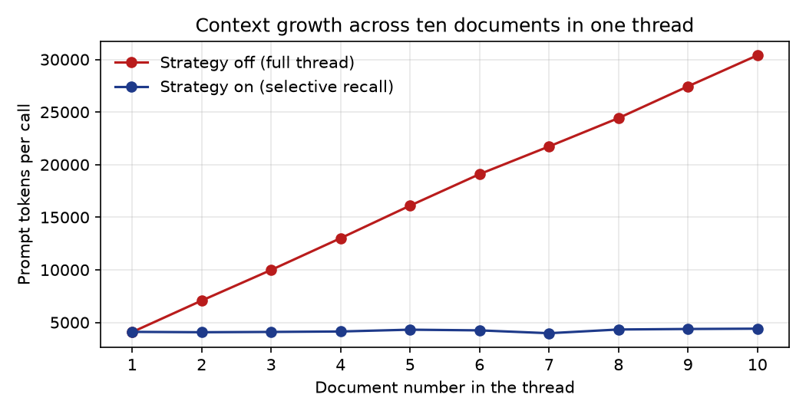

# Context-window metrics (assignment §4.5)

Ten distinct 2025 tax documents (`data/fixtures/bench_ten_docs`) are processed sequentially by the Document Extraction agent in one thread, in the same fixed order, with the same model, prompt and schema. *Strategy off* replays the whole thread on every call; *strategy on* (selective recall) sends the current document plus a compact summary of session decisions. See `scripts/context_benchmark.py` and `src/memory.py`.

## Measured input tokens per document (Anthropic API `usage`)

Model: `claude-haiku-5-5`. Runs: `bench-off-c60e30` (off, 2026-10-29T23:46:20+00:00) and `bench-on-fb3643` (on, 2026-10-29T23:46:47+00:00). Total = input + cache creation + cache read tokens.

| Doc | Form | Strategy OFF total | OFF input | Strategy ON total | ON input | Saved |
|---:|---|---:|---:|---:|---:|---:|
| 1 | W-2 | 4,079 | 4,079 | 4,103 | 4,103 | -1% |
| 2 | 1099-INT | 7,074 | 7,074 | 4,067 | 4,067 | 43% |
| 3 | 1099-DIV | 9,987 | 9,987 | 4,096 | 4,096 | 59% |
| 4 | 1099-R | 13,007 | 13,007 | 4,138 | 4,138 | 68% |
| 5 | W-2 | 16,104 | 16,104 | 4,309 | 4,309 | 73% |
| 6 | 1099-INT | 19,097 | 19,097 | 4,244 | 4,244 | 78% |
| 7 | SSA-1099 | 21,730 | 21,730 | 3,974 | 3,974 | 82% |
| 8 | 1099-DIV | 24,426 | 24,426 | 4,327 | 4,327 | 82% |
| 9 | 1099-INT | 27,445 | 27,445 | 4,376 | 4,376 | 84% |
| 10 | 1099-R | 30,396 | 30,396 | 4,405 | 4,405 | 86% |

Totals: strategy off **173,345** tokens, strategy on **42,039** tokens (76% fewer). First-to-last growth: off 4,079 -> 30,396; on 4,103 -> 4,405.

Result consistency: 10/10 documents extracted identically in both runs.

